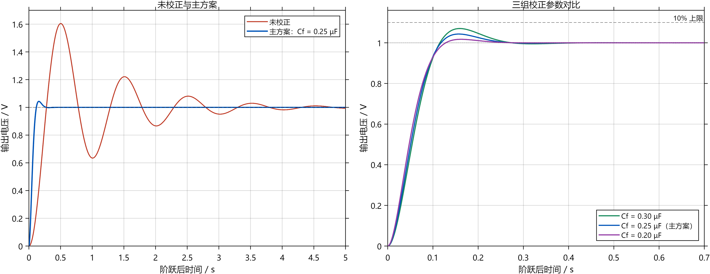
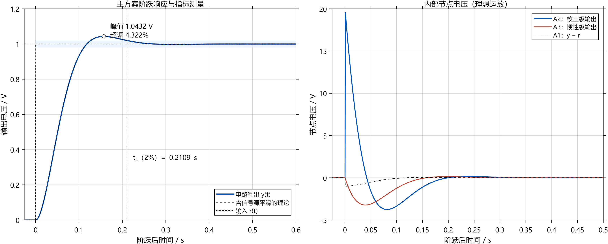

# 线性系统串联校正实验

使用 MATLAB、Simulink 与 Simscape 搭建 RC 理想运放模拟电路，比较未校正系统与三组串联超前校正参数的阶跃、方波响应，并与传递函数理论对照。仓库包含可运行模型、源代码、已有仿真数据和图件。

## 环境

已在 **MATLAB R2025a** 上验证，需要 MATLAB、Simulink、Simscape 和 Control System Toolbox。无需 Python 或 Simscape Electrical。其他 MATLAB 版本未逐一验证。

## 运行

下载并解压仓库，或执行：

```powershell
git clone https://github.com/lelala271/matlab-linear-system-correction.git
```

在 MATLAB 中将“当前文件夹”切换到仓库根目录，按需运行：

```matlab
run_experiment       % 重建电路，完成仿真、数据保存、生图和复核
plot_experiment      % 只读取已保存的数据，重新生成图件
verify_experiment    % 检查已有结果与设计指标
```

`run_experiment` 会覆盖本目录中同名的模型和结果。只运行 `plot_experiment` 不会重新求解电路，也不会读取手动仿真产生的工作区变量 `out`。

两个 SLX 模型也可直接打开运行：`original_circuit.slx` 为未校正系统，`corrected_circuit.slx` 为主方案。详细的安装、缓存设置、手动运行和故障处理见[换电脑运行教学指南](换电脑运行教学指南.md)。

## 模型与结果

原对象采用单位负反馈：

$$G(s)=\frac{20}{s(0.5s+1)}.$$

主方案的串联超前校正器及标称闭环传递函数为：

$$G_c(s)=\frac{0.5s+1}{0.025s+1},\qquad W(s)=\frac{800}{s^2+40s+800}.$$

校正网络输入与反馈电阻均为 100 kΩ，输入并联电容为 5 µF。下面三组反馈电容属于同一种校正拓扑的参数对照。

| 方案 | 反馈电容 / µF | 超调量 / % | 2% 调节时间 / s | 速度误差系数 / s⁻¹ |
|---|---:|---:|---:|---:|
| 未校正 | — | 60.4679 | 3.6586 | 20 |
| 超前校正 | 0.30 | 7.0292 | 0.2327 | 20 |
| 主方案 | 0.25 | 4.3216 | 0.2109 | 20 |
| 超前校正 | 0.20 | 1.7323 | 0.1166 | 20 |

波形来自 Simscape 电压传感器的电路仿真。1 V 阶跃于 0.1 s 发生，输入使用时间常数为 0.1 ms 的一阶平滑；调节时间从指令发生时刻起算。程序同时进行电路与理论对照、减半积分步长检查。





## 文件

- `build_circuit.m`：建立 RC、理想运放及传感器电路。
- `run_experiment.m`：仿真和理论对照的总入口。
- `plot_experiment.m`：独立生图入口。
- `verify_experiment.m`：结果复核入口。
- `original_circuit.slx`、`corrected_circuit.slx`：可直接运行的电路模型。
- `结果/`：5 张 PNG、MAT 仿真数据、3 份 CSV 和实验小结。

## 适用范围

模型使用理想运放和理想 RC 元件，未包含电源限幅、有限增益带宽、转换速率及元件容差；所得数据为仿真测量。主方案在 1 V 理想阶跃瞬间的校正级输出约为 20 V，因此实物使用 ±15 V 运放时，应降低输入幅值并重新验证。标称设计利用零极点相消，实际元件误差会影响相消效果。
